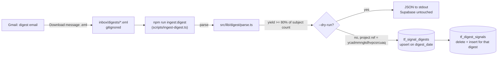

# Signal Digest ingest (PP-02)

Written 2026-11-07 (US Central) for Linear TH-36. Episodes of the Panel Podcast are built from the **Faraday Daily Signal Digest** email (`signals@faraday-intelligence.ai`, subject `Faraday Daily Signal Digest — 40 signals · 2026-11-07`). Each digest is parsed once and stored as structured rows, so PP-03 queries tables and never re-parses email.



## Daily steps

1. In Gmail, open the day's digest. Click **⋮ (More) → Download message**. Gmail saves an `.eml` file.
2. Move the file into `inbox/digests/` in this repo. The file name does not matter; the edition date comes from the subject line.
3. Check it parses, without touching Supabase:
   ```bash
   npm run ingest:digest -- inbox/digests --dry-run
   ```
4. Write it (needs `NEXT_PUBLIC_SUPABASE_URL` and `SUPABASE_SERVICE_ROLE_KEY` in `.env.local`, from `vercel env pull .env.local`):
   ```bash
   npm run ingest:digest -- inbox/digests
   ```
5. Delete the `.eml` files once they are written, or leave them; re-running is safe.

**Backlog (35 digests, 2026-09-28 → 2026-11-01).** Select them in Gmail (search `from:signals@faraday-intelligence.ai subject:"Signal Digest"`), download each as `.eml` into `inbox/digests/`, then run steps 3 and 4 once over the folder. Expect `select count(*) from tf_digest_signals` near 1,300.

A saved HTML body (`.html` / `.htm`) also works; with no subject line, the date and count come from the digest's own header line (`… → 2026-11-07 08:00 UTC · 40 signals`), then from a `YYYY-MM-DD` in the file name.

## What the CLI guarantees

- **Idempotent on `digest_date`.** The digest row is upserted on its unique `digest_date`; that digest's signals are deleted and re-inserted. Running the same file twice leaves the same rows.
- **Yield gate.** If the parser finds fewer than 80% of the signals the subject line states, that file is reported and not written, and the CLI exits 1. Other files in the same run still go in.
- **Decoy guard.** Before any write, the CLI refuses a `NEXT_PUBLIC_SUPABASE_URL` that does not name `ycadmmngkdhvpcsrcuaq` (and names the decoy `xgbpmlkanxewtfizloay` explicitly). `--dry-run` never reads credentials.
- **No secrets printed.** Logs carry US Central timestamps, file names, dates, counts and row ids only.

## Field mapping

Read from real editions (2026-09-28 and 2026-11-07, same template). The digest groups signals under section headings; its footer says "Domain names sourced from the IDF Domain Registry", so the heading is the IDF domain.

| Column | From the digest |
| --- | --- |
| `tf_signal_digests.digest_date` | Date at the end of the subject (`· 2026-11-07`); else the header window's end date; else the file name |
| `subject`, `source_message_id` | Subject header (RFC 2047 decoded); `Message-ID` without angle brackets |
| `signal_count` | `N signals` in the subject; else in the header line |
| `raw_html`, `raw_text` | The `text/html` and `text/plain` parts, kept verbatim for re-parse |
| `tf_digest_signals.position` | Order in the email, 1-based across all sections |
| `summary` | The signal paragraph, entities decoded |
| `title` | First sentence of the summary, capped at 160 characters (the digest has no separate title; `raw.title_derived = true`) |
| `source_url`, `publisher` | The "Read the source — Publisher →" link (text part: `Source (Publisher): URL`) |
| `idf_domain` | Section heading, verbatim (e.g. `Chips & Density`, `Grid & Regulatory`) |
| `idf_subdomain`, `confidence` | Not in today's digest. If a block ever carries `Confidence: High` or an IDF code like `D2.3`, they are stored verbatim |
| `published_at`, `jurisdiction`, `signal_type`, `entities` | Not in the digest: `null`, `null`, `null`, `[]` |
| `raw` | `section`, `position_in_section`, `title_derived`, `source_label`, plus `extra` (any unrecognised text in the block) and `missing_source` when there is no link |

The **Counties with Moratoriums** list at the end of each digest is a standing appendix (no sources, not counted in the subject). It is not stored as signals; it stays in `raw_html` / `raw_text` and appears under `appendix` in `--dry-run` output.

The parser prefers the HTML part and falls back to the `text/plain` part when the HTML is missing or yields nothing. Both give identical signals on the fixture.

## Files

- `supabase/migrations/20261107_pp02_signal_digests.sql`: both tables, indexes, RLS on with no policies (service role only). `tf_signal_digests` is also created by TH-47's migration with the same shape; both use `if not exists`.
- `src/lib/digest/parse.ts`: the parser (dependency-free; usable from the app and from scripts).
- `scripts/ingest-digest.ts`: the CLI.
- `fixtures/digests/2026-11-07.eml`: a real digest with transport headers and the recipient removed. `fixtures/digests/2026-09-23-edge-cases.html`: the same template with hypothetical items, covering an HTML-only export, a "showing top N of M" header, a missing source link and an unknown block.
- `scripts/tests/digest-ingest.test.ts`: parser unit tests and a dry-run CLI test that points Supabase at the decoy with no key.

## Follow-up (Faraday side, not this issue)

The fully hands-off alternative is the signals engine writing the digest JSON straight into `tf_signal_digests` / `tf_digest_signals` at send time. That removes the Gmail export step.
