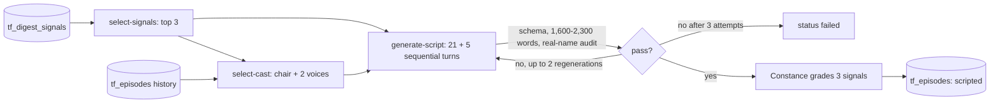

# Episode script generator (PP-03)

Written 2026-11-07 for Linear TH-37. Turns one day's Signal Digest into a timed, speaker-tagged script for the Panel Podcast, plus show notes, and stores it as a `tf_episodes` row (status `scripted`). PP-04 (audio) reads that row; nothing here makes audio.

```bash
npm run podcast:script -- --date 2026-11-01 [--nn 01] [--dry-run]     # pnpm run works the same
```

Needs `NEXT_PUBLIC_SUPABASE_URL` and `SUPABASE_SERVICE_ROLE_KEY` (from `.env.local`) to read `tf_digest_signals` and write `tf_episodes`, and `ANTHROPIC_API_KEY` for the model. The project ref is asserted to be `ycadmmngkdhvpcsrcuaq` before any Supabase call; the decoy is refused. Keys are never printed.

Flags: `--dry-run` writes nothing to Supabase · `--nn` episode number of the day (default: next free) · `--cast chair,voice,voice` · `--show "Name"` (default "The ThoughtForge Panel") · `--digest-file <.eml|.html>` read signals from a saved digest instead of Supabase · `--replace` overwrite a `scripted` or `failed` row · `--out <dir>` (default `out/podcast`).
Every run dumps `script.json`, `show-notes.md`, `episode-row.json` and `audit.json` (attempts, real-name audit, grades) to `<out>/<episode_id>/`. Exit code 1 if the episode ends `failed`.

**Offline, no key:** `TF_MOCK=1 npm run podcast:script -- --date 2026-11-07 --digest-file fixtures/digests/2026-11-07.eml --dry-run --out fixtures/podcast` uses a deterministic mock model. `fixtures/podcast/PP-20261107-01/` is that output: an example of the shape, not episode copy.

## Pipeline



1. **Signals** (`src/lib/podcast/select-signals.ts`). Rank by confidence CF5..CF0, then the initial-focus domains {D2, D3, D7, D10, D14}, then recency, then digest position, then id; top 3. Anything labelled or worded as a projection, forecast or estimate is held below SRC (CF3), per IDF R5. The digest carries no per-signal confidence or date today, so an unlabelled signal with a source link is CF3 (without a link, CF1) and recency falls back to position; both are written into `tf_episodes.signals[].rationale`.
2. **Roster** (`select-cast.ts`). Chair is `gilbert-faraday`, or `margo-brandt` if he is a voice. Voices come from the signals' domains: D2/D3 → mach-eigen or albert-thorne · D7, D1 → ingrid-halverson · D13/D18 → hartford-nakamura or rosalind-ferraro · D19 → hartford-nakamura · D4 (capital/markets) → victoria-stroud. Ties go to the panelist least recently on-mic (`tf_episodes.cast` history, never-on-mic first, then slug). D10/D14 are the chair's domains and seat no voice; D5/D22 map only to off-mic personas. If the signals name fewer than two voices, the rest are filled from the pool by the same rotation. `constance-wright` and `delia-marchetti` are never on-mic.
3. **Script** (`generate-script.ts`). Cold open (chair, ~80 words) → 3 signal segments → The Read (chair, two turns, ~150 words) → sign-off (~30 words). Each signal segment is 7 turns: chair asks, voice A, voice B (must disagree on a specific point), chair probes, A, B, chair arbitrates and ends with one sentence restating the disagreement. Turns are under 90 words (retried once if over, then trimmed). Total must be 1,600 to 2,300 words (target 1,900); outside the band, or on a schema or audit failure, the whole script is regenerated up to twice, then the row is written `failed` with the reason.
4. **Show notes** (`show-notes.ts`). Title, three signal bullets with source links, Constance Wright's evidence grade per signal (grade only, from one fact-check call over the three signals, `grade-signals.ts`), on-mic cast, and the selection rationale. Her grades are never in the audio.

## How podcast mode differs from /ask

| | `/api/ask` | podcast mode |
| --- | --- | --- |
| Cast | all eight panelists, then Constance, then Gilbert | 3 on-mic (chair + 2 voices), Constance grades off-mic |
| Orchestration | eight replies in parallel, one ruling | sequential dialogue turns, each sees the transcript so far |
| Prompt | `composeSystemPrompt(...)` with the tagged evidence-ladder contract | same composer and persona stack, `mode: "podcast"` swaps in the spoken contract (no `[SRC]` tags, no 120 to 220 word rule, ladder said in plain speech) |
| Facts | retrieved artifacts | the selected signals, as the retrieved block |
| Models | Sonnet 5.5 panelists; Opus 5.5 ruling | Sonnet 5.5 turns (thinking off, effort medium); Opus 5.5 effort low for the cold open and The Read; no `temperature` (TF-DEC-57) |
| Output | SSE session | `EpisodeScript` JSON (`script-schema.ts`) in `tf_episodes.script` |

`ask` mode output is unchanged: `composePanelistCore(member, shared)` is byte-identical to before.

## Overriding the cast

`--cast gilbert-faraday,mach-eigen,ingrid-halverson` means chair, voice, voice. It must be three distinct known slugs, none of them off-mic; if `gilbert-faraday` is a voice, `margo-brandt` must chair. The override is recorded in `tf_episodes.signals.cast_rationale`.

## Real-name audit (TF-DEC-61)

`scripts/lib/podcast-audit.ts`, built on the same extractor and lexicon as `npm run audit:cast`. Failures: a speaker off the cast or off-mic; a real person from the people spine outside the speaker's own network; an archetype reference; any non-cast name inside a friend / mentor / colleague / endorser sentence. A public figure may appear as the subject of a selected signal. Person-shaped names that nothing explains are listed under `real_name_audit.review` in `audit.json` (not failing; read them before approving).

## Storage

`tf_episodes` (`supabase/migrations/20261107_pp03_episodes.sql`, applied by Myke): RLS on, anon may SELECT only `status = 'published'`; all writes are the service role. `signals` holds the ranking rationale, grades and cast rationale; a failed row carries `signals.failure` with each attempt.

## Files

`src/lib/podcast/{select-signals,select-cast,script-schema,generate-script,grade-signals,show-notes,episode,llm,mock-llm}.ts` · `scripts/make-episode.ts` · `scripts/lib/podcast-audit.ts` · `src/cast/prompt.ts` (`mode`) · `scripts/tests/podcast.test.ts`.
